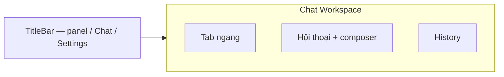

# Layout & shell

Tham chiếu Cursor IDE (không phải Agents Window). Viewport desktop; không scale cả cửa sổ như ảnh.

## Khối

- **TitleBar** (`TitleBar.tsx`): full width, `-webkit-app-region: drag`. Logo, menu File…Help, ← →, tên folder, **Toggle Panel → Chat → Settings**, − □ ×. Icon Chat (giữa panel và Settings) bật/tắt **cả** Chat Workspace. Nút panel (Ctrl+J) mở panel dưới: Terminal, Output; Problems / Debug Console / Ports = chưa gắn.
- **Không** cột icon dọc trái. **Không** Explorer trong Chat Workspace (không cây file, không icon thư mục trên sidebar).
- **Chat Workspace** (khi hiện): hàng tab ngang trên khung chat + hội thoại giữa + lịch sử phải. Tab không đè panel lịch sử.
- **Thanh Agents** (panel lịch sử phải): nút góc trên phải ẩn/hiện panel — tooltip `Toggle Agents Side Bar (Ctrl+Alt+U)`. Khi ẩn, nút hiện lại ở cuối hàng tab. Không xóa lịch sử.
- **Ẩn Chat Workspace:** titlebar còn; vùng giữa trống. Bấm icon Chat lại để hiện cả khối.
- **Tab ngang** (`ChatTabBar.tsx`): icon bong bóng + tiêu đề + nút đóng; nút + = New Agent. Đóng tab không xóa lịch sử. Click lịch sử → mở/focus tab.
- **History** (`ChatHistoryPanel.tsx`): New Agent, Search, Automations (chưa gắn), Customize → Appearance, list thread theo ngày.
- **Workspace chat:** chỉ hội thoại + composer. **Không** ProjectHeader. `ProjectHeader.tsx` / `ContextPanel.tsx` / `Sidebar.tsx` không mount.
- **DiffPane:** chỉ khi `diff || file` (không hiện Changes rỗng).
- Mở folder: File → Mở workspace (vẫn cần cho agent).

## Grid

`--sidebar-w: 264px`, `--context-w: 310px`.

- Chat hiện: `1fr | history`
- Chat ẩn: `1fr`

`overflow: hidden` trên workspace; composer `overflow: visible` để dropdown.

Thanh cuộn dọc (chat / Agents / panel Terminal·Output): thumb ~4px bo tròn, gần ẩn — hiện rõ khi hover; cuộn hội thoại trên `.chat-pane` (`docs/frontend/tokens.md`).

## Composer neo đáy

Trong `.chat-col`: `ChatPane` flex 1, `composer-stack` flex none, max-width 760px, căn giữa. Composer thuộc Chat Workspace.

## Shell flags (localStorage)

| Key | Ý nghĩa |
| --- | --- |
| `silence.shell.view` | `chat` (mặc định) hoặc `hidden` |
| `silence.shell.openTabs` | JSON mảng id thread đang mở |
| `silence.shell.history` | `1` = ẩn thanh Agents |
| `silence.shell.panel` | `1` = hiện panel Terminal/Output |
| `silence.shell.workspace` | path folder |

Mở thread / New Agent: hiện Chat Workspace, hiện composer, focus textarea.
