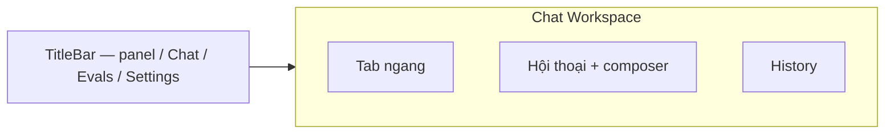

# Layout & shell

Tham chiếu Cursor IDE (không phải Agents Window). Viewport desktop; không scale cả cửa sổ như ảnh.

## Khối

- **TitleBar** (`TitleBar.tsx`): full width, `-webkit-app-region: drag`. Logo, menu File…Help, ← →, tên folder, **Toggle Panel → Chat → Evals → Settings**, − □ ×. Icon Chat (sau panel) bật/tắt **cả** Chat Workspace. Icon Evals chỉ hiện ở checkout có `evals/`, mở trang Evals thay khung chat và hiện chip tiến độ khi đang chạy (`evals.md`). Nút panel (Ctrl+J) mở panel dưới: Terminal, Output; Problems / Debug Console / Ports = chưa gắn.
- **Không** cột icon dọc trái. **Không** Explorer trong Chat Workspace (không cây file, không icon thư mục trên sidebar).
- **Chat Workspace** (khi hiện): hàng tab ngang trên khung chat + hội thoại giữa + lịch sử phải. Tab không đè panel lịch sử.
- **Thanh Agents** (panel lịch sử phải): nút góc trên phải ẩn/hiện panel — tooltip `Toggle Agents Side Bar (Ctrl+Alt+U)`. Khi ẩn, nút hiện lại ở cuối hàng tab. Không xóa lịch sử.
- **Ẩn Chat Workspace:** titlebar còn; vùng giữa trống. Bấm icon Chat lại để hiện cả khối.
- **Tab ngang** (`ChatTabBar.tsx`): icon bong bóng + tiêu đề + nút đóng; nút + = New Agent. Đóng tab không xóa lịch sử. Click lịch sử → mở/focus tab.
- **Settings** (`settings/SettingsDialog.tsx`): nút Settings trên TitleBar (và Customize ở lịch sử, chip "More") mở **hộp lớn giữa màn hình** (~980×700, nền mờ; Esc / × / bấm nền để đóng; Tab không thoát ra ngoài hộp). Cột trái: ô **Tìm cài đặt**, rồi Chung · Giao diện · Trò chuyện · Thông báo · Quyền · Model · Công cụ (MCP) · Dữ liệu, ngăn cách, Phím tắt · Giới thiệu; mục cuối nhớ ở `silence.settings.section`. Bên phải: các hàng `SettingRow` (nhãn + mô tả bên trái, điều khiển bên phải). Tìm kiếm khớp nhãn/mô tả theo ngôn ngữ UI và từ khoá hai thứ tiếng, không phân biệt dấu (`settingsIndex.ts`); bấm kết quả → mở mục, cuộn tới hàng và nháy. Giao diện / ngôn ngữ / quyền áp dụng ngay. Tuỳ chọn không thuộc giao diện nằm ở `prefs.ts` (`silence.prefs.v1`):
  - **Chung:** Mở lại các tab chat lần trước (tắt = mở với chat trống).
  - **Giao diện → Code & terminal:** font, cỡ chữ (12–15), minimap cho editor/diff và terminal; terminal lấy màu từ token theme.
  - **Trò chuyện:** chế độ xem mặc định (Gọn · Suy nghĩ · Chi tiết, xem `chat.md`), phong cách trả lời (`session.set_style` trước mỗi lượt), tự đặt tên chat (huy hiệu **Tốn lượt gọi** cho mọi tuỳ chọn có gọi model).
  - **Thông báo:** khi cần duyệt, khi agent xong (chỉ tên chat), nháy taskbar, giữ máy thức khi chạy (`powerSaveBlocker` ở main), nút Gửi thử. Chỉ báo khi cửa sổ không ở phía trước.
  - **Công cụ (MCP):** server của workspace (`.silence/mcp.json`); server có sẵn trong file phải được **Cho phép** trên máy này trước khi chạy; thêm server phải xác nhận lệnh; env chỉ hiện tên biến.
  - **Dữ liệu:** giữ lịch sử chat (Mãi mãi · 90 · 30 · 7 ngày, dọn khi mở Studio, chat ghim luôn giữ), Xoá toàn bộ (bấm hai lần), mở thư mục dữ liệu. Audit log không bao giờ bị xoá.
  - Không lấy từ Claude Code: bypass permissions (trái "không silent YOLO"), Remote Control (không bind LAN), branch/PR/cloud (5ilence không có luồng git). Mục **Model** nhúng `NetworkPanel` (Save/Cancel/Reset riêng, xem `composer.md`); đóng hộp hoặc đổi mục khi Model còn bản nháp → hộp thoại Lưu / Bỏ / Ở lại. Settings không thay khung chat nữa.
- **History** (`ChatHistoryPanel.tsx`): New Agent, Search, Automations (chưa gắn), Customize → Settings, list thread theo ngày. Nhóm **Đã ghim** đứng đầu; chat **lưu trữ** rời khỏi tab, nằm trong nhóm "Đã lưu trữ (n)" thu gọn ở cuối (search vẫn lọc). Mỗi dòng có nút ⋯ (hover) mở menu: Mở ở tab mới · Ghim (P) · Đánh dấu chưa đọc (U, chấm copper + tiêu đề đậm, tự xoá khi mở) · Đổi tên (R, double-click vẫn được) · Fork cả chat (F, khoá khi đang chạy lượt) · Copy dạng Markdown · Copy session ID · Lưu trữ (A) · Xoá (D, bấm lần hai mới xoá). Mũi tên lên/xuống, Esc đóng.
- **Workspace chat:** chỉ hội thoại + composer. **Không** ProjectHeader. `ProjectHeader.tsx` / `ContextPanel.tsx` / `Sidebar.tsx` không mount.
- **DiffPane:** chỉ khi `(diff || file)` **và user chủ động mở** (`reviewOpen`): bấm card diff trong chat, chip file, hoặc mở file. Có diff mới thì chỉ hiện card trong chat, panel **không tự bật** (đang đóng thì giữ đóng; đang xem một file thì giữ). Đóng bằng ✕. Không hiện Changes rỗng. Có `diff` → `DiffEditor` before/after (readOnly, ẩn vùng không đổi, không overview ruler) kèm header file (`+N −M`, Reject/Apply); chỉ có `file` → editor thường. Danh sách file có badge `M`/`A` và `+N −M`. Monaco nạp cục bộ (`renderer/monaco.ts`), không dùng CDN vì CSP chặn; theme `silence-dark`/`silence-light` đọc màu từ token CSS và đổi theo Appearance.
- Mở folder: File → Mở workspace (vẫn cần cho agent).

## Grid

`--sidebar-w: 264px`, `--context-w: 310px`.

- Chat hiện: `1fr | history`
- Chat ẩn: `1fr`

`overflow: hidden` trên workspace; composer `overflow: visible` để dropdown.

Thanh cuộn dọc (chat / Agents / panel Terminal·Output): thumb ~4px bo tròn, gần ẩn — hiện rõ khi hover; cuộn hội thoại trên `.chat-pane` (`docs/frontend/tokens.md`).

## Composer neo đáy

Trong `.chat-col`: `ChatPane` flex 1, `composer-stack` flex none, max-width 760px, căn giữa. Composer thuộc Chat Workspace.

## Shell flags (localStorage)

| Key | Ý nghĩa |
| --- | --- |
| `silence.shell.view` | `chat` (mặc định) hoặc `hidden` |
| `silence.shell.openTabs` | JSON mảng id thread đang mở |
| `silence.shell.history` | `1` = ẩn thanh Agents |
| `silence.shell.panel` | `1` = hiện panel Terminal/Output |
| `silence.shell.workspace` | path folder |
| `silence.prefs.v1` | Tuỳ chọn Settings ngoài giao diện (`prefs.ts`): chat, code, thông báo, lịch sử |

Mở thread / New Agent: hiện Chat Workspace, hiện composer, focus textarea.
