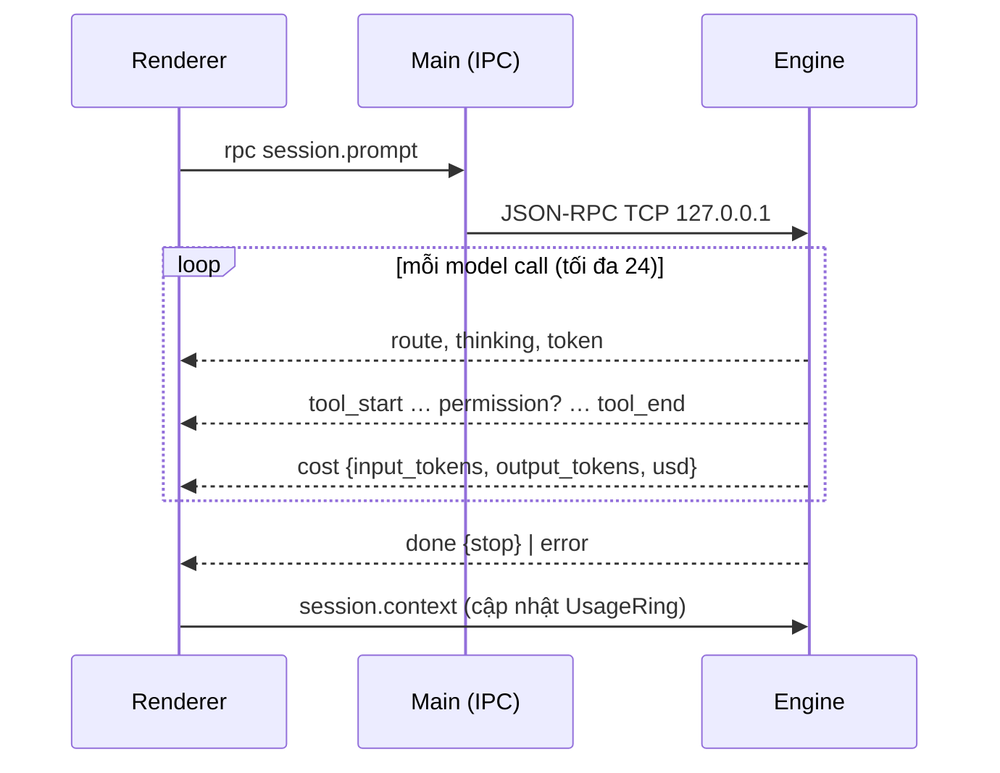
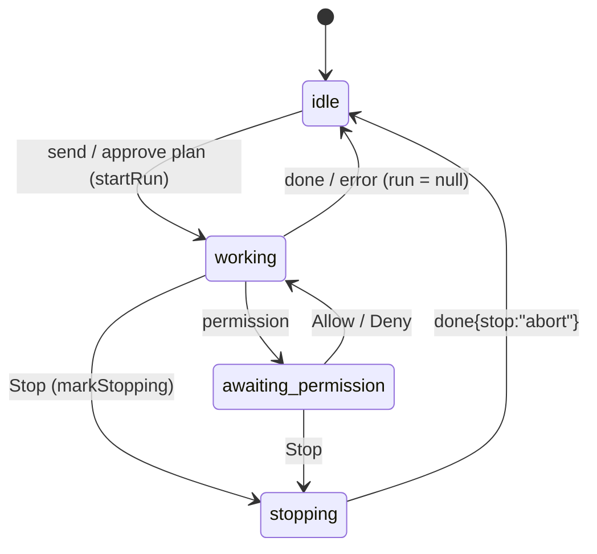

# Chỉ báo trạng thái phiên

Mục tiêu: lúc nào user cũng trả lời được 4 câu hỏi mà không phải đọc log:

1. **Còn sống không?** Đồng hồ đang chạy, có nhịp.
2. **Đang làm gì?** Nhãn bước: Reading, Running, Editing…
3. **Có cần tôi không?** Đang chờ duyệt quyền hoặc duyệt plan.
4. **Đã tốn bao nhiêu, đã đổi gì?** Token/context, thay đổi file, task còn lại.

Mọi chỉ báo đều **do renderer dựng từ event của Engine**. Model không tự viết ra chúng; renderer không gọi model (xem `frontend-boundary`).

## Tham khảo

| Nhóm | Claude Code | Cursor | Codex / khác | 5ilence |
| --- | --- | --- | --- | --- |
| Run pulse | Spinner, nhãn hoạt động, elapsed, token, Stop | "Generating…", Stop | "Working (Ns • esc to interrupt)" | Nhãn bước + `Working · 1m 12s · 5.9K tokens` |
| Chờ user | Phiên "waiting on you" | Thẻ Accept/Run | Approval prompt | `Waiting for approval` (accent) + chấm ở lịch sử |
| Task list | TodoWrite, checklist ghim | Agent To-dos | `update_plan` | `update_todos` (S3) |
| Context | `Context 8%`, auto-compact | Vòng % | "% context left" | `UsageRing` (đã có) + báo compact (S2) |
| Changes | `+N −M`, Create PR | Review changes, Keep/Undo all | PR | Tổng `+N −M` (S2); PR sau v1 |
| Environment | Máy, folder, nhánh | Workspace, nhánh | | Workspace + nhánh (S2) |
| Background | Lệnh nền, ■, "N finished" | Background Agents | | S4 (Phase 5) |
| Cost | `/cost` | Usage dashboard | | S5 (Phase 6) |

## Kiến trúc



- `cost` được phát **sau mỗi model call**, không phải một lần mỗi lượt. Renderer cộng dồn trong `RunMeter` (`runStatus.addCost`).
- Abort: `session.abort` chỉ đặt cờ, và Engine kiểm cờ ở đầu vòng. Vì thế "Stopping…" có thể kéo dài tới khi model call hoặc tool hiện tại xong (cải thiện ở S3).

## State machine lượt



Bên trong `working`, nhãn bước (Planning → Thinking → Reading…) đi theo hợp đồng ở [chat.md](chat.md). `runPhase()` chỉ thêm ba pha phủ lên trên: `working`, `awaiting_permission`, `stopping`. Stop thắng permission.

## Run pulse (S1 — đã làm)

Vị trí: dòng summary của lượt live (`AgentMeta` trong `ChatPane.tsx`), thay chữ "Working…" cũ. Xong lượt thì quay về `Worked for Ns` như cũ.

| Pha | Hiển thị | Màu |
| --- | --- | --- |
| working | `Working · 1m 12s · 5.9K tokens` | `--text-secondary` |
| awaiting_permission | `Waiting for approval · 1m 12s · …` | `--accent` |
| stopping | `Stopping… · 1m 12s · …` | `--text-muted` |

Quy tắc:

- Elapsed tính từ lúc gửi (`turnStartedAtRef`). Đồng hồ tick 1s **chỉ khi lượt live**, dùng `font-variant-numeric: tabular-nums` để chữ không nhảy ngang.
- Token = **output** của lượt, format bằng `fmtTok`. Chưa có `cost` thì không hiện phần token.
- Tooltip: `Lượt này: 12K input · 800 output · $0.0042`. Input cộng qua nhiều call nên lớn hơn kích thước context; đó là số đã tính phí, không phải context.
- Nhãn pulse là tiếng Anh, cùng giọng với "Worked for" và "Thought". Tooltip và thông báo lỗi là tiếng Việt.
- Lịch sử (`ChatHistoryPanel`): chấm của thread đang mở nhấp nháy khi chạy, đổi sang màu accent khi chờ duyệt. Tôn trọng `prefers-reduced-motion`. Engine chỉ đẩy event của session đang mở, nên chấm chỉ áp dụng cho thread đó.
- Không toast, không âm thanh, không đếm ngược giả.

## Ai quyết định cái gì (3 tầng)

Áp dụng cho mọi dòng trạng thái, theo mẫu của Claude Code:

| Tầng | Quyết định | Ví dụ ở 5ilence |
| --- | --- | --- |
| Model | Gọi tool nào, với tham số gì; nội dung chữ (`description`, plan, todo) | `read{path, offset, limit}`, `submit_plan{markdown}` |
| Harness (Engine) | Có những tool nào, schema, thực thi, hỏi quyền, phát event | `crates/tools` (schema), `agent/mod.rs` (`tool_start`/`tool_end`/`permission`) |
| UI (renderer) | Động từ, thì hiện tại/quá khứ, gộp nhóm, đồng hồ, `+N −M` | `chatMeta.ts`, `runStatus.ts`, `ChatPane.tsx` |

Hệ quả: model không biết các dòng trạng thái tồn tại. Đổi cách hiển thị thì sửa renderer. Chỉ khi cần *dữ liệu mới* (ví dụ câu mô tả) mới phải đổi schema tool, và khi đó phải kèm eval.

## Gộp các lần Read (đã làm)

Mẫu tham khảo: Claude Code hiển thị `Read App.tsx (1–40, 615–629, 835–894)`.

- `narrateToolLive` gắn `file` (đường dẫn đầy đủ) và `ranges` vào bước đọc. Khoảng dòng lấy từ `offset`/`limit` của tool `read`:
  - có cả `offset` và `limit` → `offset–(offset+limit−1)`
  - chỉ có `limit` → `1–limit`
  - chỉ có `offset` → `offset+`
  - không có cả hai → đọc cả file, không hiện khoảng
- `mergeReadSteps` gộp **các bước liền nhau cùng file**. Một bước khác chen giữa (Edited, Searched, hay đọc file khác) sẽ cắt nhóm. Đọc A, sửa A, rồi đọc lại A cho ra 3 dòng, giống Claude.
- Hợp khoảng dòng: sắp xếp, nối các khoảng chồng nhau hoặc liền kề (`1–40` + `41–60` → `1–60`). Một lần đọc cả file thì cả nhóm thành cả file. Quá 4 khoảng thì hiện `… +N`.
- Khi đang chạy, bước gộp lấy động từ của lần đọc mới nhất (`Reading`). Xong thì đổi thành `Read`.
- `file`/`ranges` được lưu trong dòng `narrate` của thread. Thread cũ không có hai trường này thì hiển thị như trước, không gộp.
- Gộp chỉ xảy ra lúc hiển thị (`displaySteps`). Mỗi lần gọi vẫn là một `tool` trong "Tool details".

## Duyệt plan: 4 lựa chọn (S3)

Mẫu tham khảo: Claude Code có Reject / Revise… / Accept / Accept and use auto mode. 5ilence giữ cấu trúc 4 nút nhưng **không có YOLO**: "tự động" chỉ áp dụng cho việc sửa file, có giới hạn rõ ràng và luôn hiện trên màn hình.

| Nút | Hành vi | Engine |
| --- | --- | --- |
| **Từ chối** | Bỏ plan, vẫn ở mode Plan, card thu gọn thành "Plan đã bị từ chối" | `session.reject_plan` (mới) hoặc chỉ xử lý ở client |
| **Sửa…** | Mở composer, điền sẵn "Sửa plan: ", giữ plan cũ trong ngữ cảnh | Như "Góp ý / sửa" hiện tại |
| **Duyệt** (mặc định, `Ctrl+Enter`) | Chuyển sang Agent, implement. Mọi quyền vẫn là `ask` | `session.approve_plan` (đã có) |
| **Duyệt + tự sửa file** | Như Duyệt, và tự cho phép `write`/`edit` **trong workspace, cho lượt implement này** | `session.approve_plan {auto_edits: true}` |

Quy tắc cho "Duyệt + tự sửa file":

- Chỉ áp dụng cho tool sửa file trong workspace. `shell`, mạng, MCP, xoá file, và đường dẫn ngoài workspace **vẫn hỏi**.
- Hết hiệu lực khi lượt kết thúc (done/error/Stop). Không ghi vào danh sách quyền đã lưu.
- Không im lặng: composer hiện chip `Tự sửa file · Tắt`, mỗi lần sửa vẫn có DiffCard và checkpoint để Restore, audit ghi `permission.auto` kèm `plan_id`.
- Nút chính (focus mặc định) là **Duyệt**, không phải nút tự động. Cố ý khác Claude, vì nguyên tắc sản phẩm là "permission mặc định `ask`".

## Câu mô tả cho lệnh (`description`, S3)

**Cần, nhưng không bắt buộc.** Hiện nhãn đang chạy là chính câu lệnh (`Running python -c "import …"`): khó đọc với lệnh dài hoặc pipeline.

- Thêm tham số tuỳ chọn `description` (≤ 60 ký tự) cho `shell`, có thể thêm cho `task`. Schema ghi rõ: "Short human-readable label, e.g. 'Run calc tests'". Hướng dẫn trong SYSTEM ở `modes.rs`.
- UI dùng `description` làm `detail` của bước (`Running Run calc tests`). Câu lệnh thật nằm trong tooltip và "Tool details". Không có `description` thì quay lại hiện câu lệnh như hiện tại.
- **An toàn:** card xin quyền luôn hiện **câu lệnh thật**, không bao giờ chỉ hiện `description`, vì model có thể mô tả sai. Remember/allowlist khớp theo lệnh, không theo mô tả.
- Đổi schema tool là đổi harness, nên phải thêm eval task: kiểm có `description` và nó không lệch với lệnh.

## Báo tool sớm (`tool_pending`, Phase 3)

**Có ích nhưng chưa gấp.** Engine phát `tool_start` chỉ sau khi model viết xong toàn bộ tool call. Khi model ghi một file lớn, phần tham số có thể stream rất lâu; trong lúc đó UI vẫn hiện "Planning/Thinking", chỉ có đồng hồ chạy.

- Phiên bản nhẹ: gateway phát `tool_pending{call_id, name}` ngay khi thấy tên tool trong stream, chưa kèm tham số. UI hiện động từ trước (`Editing…`, `Creating…`), rồi điền tên file khi `tool_start` tới. Cùng `call_id` thì thay thế, không tạo bước mới.
- Không parse JSON tham số dở dang (dễ sai). Không hỏi quyền trước khi có `tool_start`.
- Đổi protocol (TS + Rust) và `gateway.rs`. Làm cùng chỉ tiêu độ trễ của Phase 3 (TTFT < 1.5s).

## Lộ trình

| Stage | Nội dung | Thay đổi | Phase ROADMAP |
| --- | --- | --- | --- |
| S0 ✅ | Spec này | docs | — |
| S1 ✅ | Run pulse + chấm lịch sử; gộp Read liên tiếp cùng file | renderer (`runStatus.ts`, `chatMeta.mergeReadSteps`) | 1 |
| S2 | **Session rail**: tab "Phiên" trong panel phải, cạnh Lịch sử. Gồm Environment (workspace, nhánh git), Context (dùng lại `contextUsage.ts`/`usageRows`), Changes `+N −M` của các diff đã apply trong phiên (bấm để mở `DiffPane`) | Protocol: event `compact{before,after}`, RPC `workspace.status → {root, branch, dirty}` (git chỉ đọc, có timeout). TS và Rust cùng đổi | 1–2 |
| S3 | **Task list**: tool `update_todos{items:[{content,status}]}` → event `todos`. `TodoList` ghim dưới lượt cuối và trong rail. Plan card dùng `done/total` thật thay cho 8% hard-code. **Duyệt plan 4 nút** (có "Duyệt + tự sửa file"). **`description` cho `shell`**. Abort cắt được stream và tool đang chạy; Stop khi đang chờ duyệt thì tự Từ chối | tools, runtime (`modes.rs` SYSTEM, `plan.rs`), protocol, eval mới | 2 |
| Phase 3 | **`tool_pending`**: báo động từ ngay khi biết tên tool | protocol, `gateway.rs` | 3 |
| S4 | **Background tasks**: shell `run_in_background`, registry process, RPC `task.list`/`task.kill`, event `task_update`. Rail hiện lệnh đang chạy, nút ■, "N finished". Sub-agent đang chạy | tools, runtime, sandbox (Job Object) | 5 |
| S5 | **Cost/Audit**: tổng theo session (không phải toàn cục như `cost.summary`), panel audit | runtime, renderer | 6 |
| — | Create PR, Remote/cloud | ngoài v1 (không bind LAN, commit/push phải hỏi) | sau v1 |

### Session rail (S2) — phác thảo

```text
┌ Lịch sử | Phiên ┐
│ Environment      │  workspace · nhánh main · ● dirty
│ Context    8% ── │  UsageRing + "đã tóm tắt 1 lần"
│ Tasks     2/5    │  (S3) checklist
│ Background  1 ■  │  (S4)
│ Changes +530 −69 │  → mở DiffPane
└──────────────────┘
```

Không mount lại `Sidebar.tsx` hay `ContextPanel.tsx`; rail là component mới.
